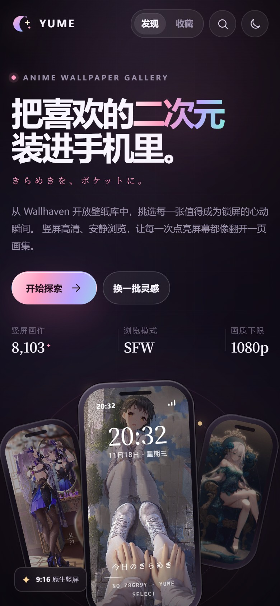
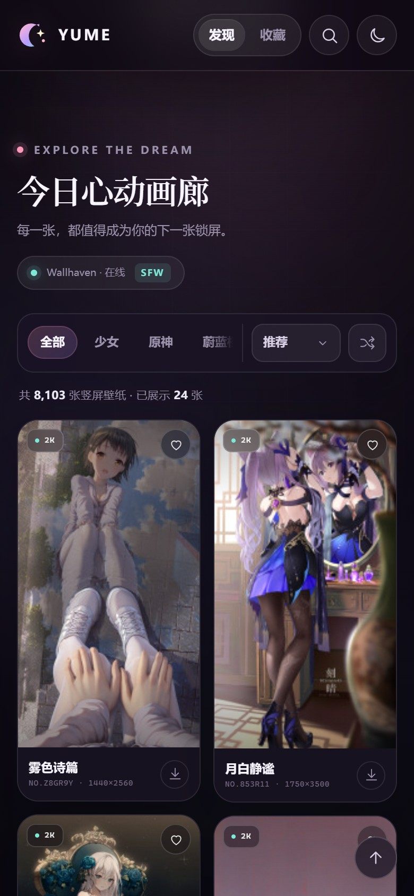
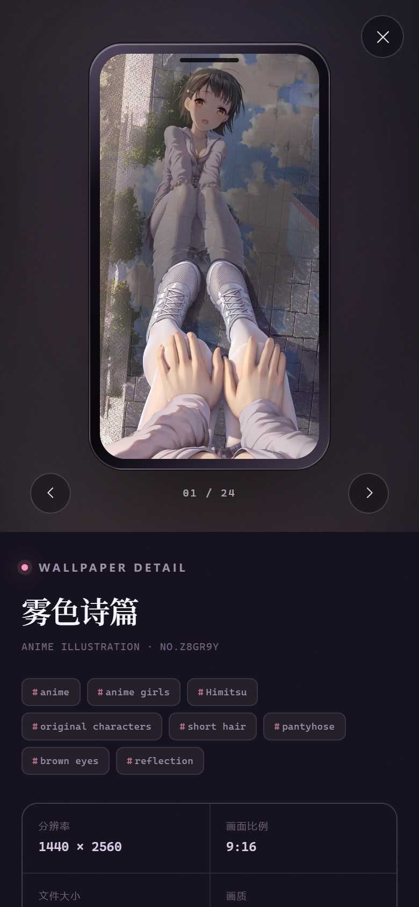
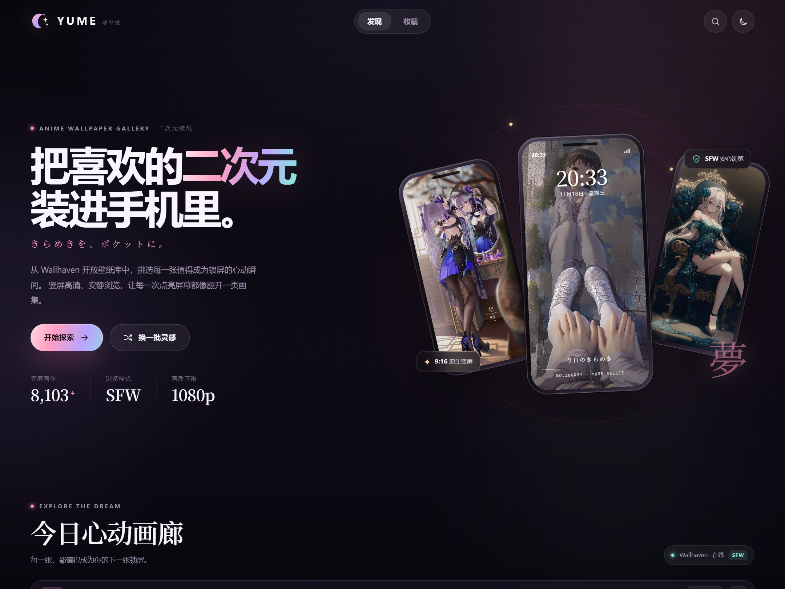

# YUME 夢壁紙

> 把喜欢的二次元，装进手机里。

一个专注 **二次元竖屏手机壁纸** 的网页画廊：真·瀑布流布局、高清预览、一键下载、本地收藏，以及安静的深色 / 明亮双主题。壁纸来自 **Wallhaven 免费开放 API**，仅请求 `SFW` 内容。



| 瀑布流画廊 | 壁纸详情 |
| --- | --- |
|  |  |



## 功能

- **真·瀑布流**：根据每张壁纸的真实宽高计算卡片高度，自动寻找最短列排版；窗口缩放、翻页追加时会重新计算，不依赖 CSS columns 的阅读顺序问题。
- **竖屏壁纸源**：Wallhaven Anime 分类，`purity=100`、`ratios=9x16,9x18,9x19.5,9x20,9x21,10x16,10x21,3x4,2x3`、至少 `1080×1920`，并默认排除 `suggestive` 标签。
- **发现 / 收藏**：收藏保存在 `localStorage`，刷新和重新打开浏览器都不会丢失。
- **搜索与主题筛选**：支持角色 / 作品 / 标签搜索，内置初音未来、原神、蔚蓝档案等中文关键词映射；提供少女、和风、赛博、星空、猫耳等快捷主题。
- **大图预览**：手机屏幕比例的预览框，展示真实分辨率、比例、文件大小、浏览 / 收藏数、原始标签和作者来源。
- **高清下载**：服务端以附件形式流式转发原图，浏览器端带进度提示与错误处理。
- **图片加速**：卡片使用轻量预览图，首屏立即出图；大图按需由服务端 `sharp` 转成 WebP，磁盘缓存后再次访问几乎零等待。
- **响应式**：从 320px 手机到 1440px+ 桌面均可使用；移动端操作区、筛选条、详情页单独适配。
- **细节**：动态手机时钟、骨架屏、滚动加载、回到顶部、键盘操作、焦点陷阱、深浅主题记忆、SFW 标识。

## 快速开始

要求 **Node.js 20+**。

```bash
pnpm install
pnpm start
```

启动后终端会打印本地地址，例如：

```text
  ✦  YUME 梦壁纸  ✦
  本地地址   http://127.0.0.1:4173
  壁纸来源   wallhaven.clbug.com · Wallhaven SFW
  缩略图引擎 sharp → WebP
```

如果默认端口被占用，服务会自动往后寻找可用端口；也可以显式指定：

```bash
# Windows PowerShell
$env:PORT="8080"; pnpm start

# macOS / Linux
PORT=8080 pnpm start
```

想在手机上通过同一局域网访问：

```bash
HOST=0.0.0.0 PORT=8080 pnpm start
```

然后手机访问 `http://电脑局域网IP:8080`。

### 部署到线上

项目已附带 Dockerfile、Render Blueprint、Railway 配置以及 VPS 的 systemd / Nginx / Caddy 模板，完整步骤见 **[DEPLOY.md](DEPLOY.md)**。

最简单的路线：把项目推到 GitHub，在 Render 用 **New → Blueprint** 导入即可；正式运营更推荐 VPS + Docker + Nginx/Caddy。

## 壁纸来源与配置

壁纸数据来自 [Wallhaven](https://wallhaven.cc/) 的公开 API，默认使用可访问的公开镜像节点：

```bash
# 默认值
WALLHAVEN_BASE=https://wallhaven.clbug.com/api/v1
```

正式部署时建议切换为官方 API，并按需配置 API Key：

```bash
WALLHAVEN_BASE=https://wallhaven.cc/api/v1
WALLHAVEN_API_KEY=你的_API_Key
```

> Wallhaven API 是免费的，未登录状态下有频率限制；本项目在服务端做了搜索缓存、请求去重和图片磁盘缓存。如果官方接口在当前网络不可达，会自动使用默认镜像地址。所有请求都只包含 `purity=100` 的 SFW 作品。

如需额外允许其他图片域名（例如自建反代），可以配置：

```bash
ALLOWED_IMAGE_HOSTS=wallhaven.cc,wallhaven.clbug.com,你的图片域名
```

默认的搜索排除词可以通过环境变量调整，留空表示不额外排除：

```bash
SEARCH_EXCLUSIONS="-suggestive"
```

## 项目结构

```text
.
├─ public/
│  ├─ index.html        # 页面骨架、内联 SVG 图标
│  ├─ styles.css        # 设计系统、瀑布流、响应式、双主题
│  ├─ app.js            # 数据请求、瀑布流、筛选、搜索、收藏、预览
│  ├─ theme-init.js     # 首屏无闪烁主题初始化
│  └─ assets/favicon.svg
├─ server.mjs           # 零框架 Node 服务：静态站 + API 代理 + 图片处理
├─ docs/                # README 预览图
└─ package.json
```

服务端接口：

| 接口 | 说明 |
| --- | --- |
| `GET /api/wallpapers?page=1&sorting=favorites&q=...&seed=...` | 代理 Wallhaven 搜索，并归一化为前端数据结构 |
| `GET /api/wallpaper/:id` | 壁纸详情、真实标签、作者与来源 |
| `GET /api/preview/:id` | 快速预览小图（优先使用 Wallhaven 原比例缩略图） |
| `GET /api/thumb/:id?w=720` | 按宽度生成 WebP 大图，支持磁盘缓存 |
| `GET /api/download/:id` | 下载原图，带 `Content-Disposition` |
| `GET /api/health` | 服务状态、来源、缩略图引擎、缓存条目数 |

## 自定义

- **调整主题色 / 字体**：修改 `public/styles.css` 顶部的 `[data-theme="night"]` 与 `[data-theme="day"]` 变量。
- **增加筛选主题**：在 `public/index.html` 的 `#moodChips` 中加入 `data-mood`、`data-query` 按钮即可，前端会自动处理。
- **中文搜索映射**：在 `public/app.js` 的 `SEARCH_ALIASES` 中补充「中文关键词 → 英文标签」。
- **排序方式**：在 `public/index.html` 的 `#sortSelect` 中增加 `value`，并同步 `public/app.js` 的 `SORT_VALUES`；服务端会校验允许的排序值。

## 说明

- 本项目只做壁纸的浏览与跳转，不存储、不打包分发壁纸文件；所有作品版权归原作者与 Wallhaven 社区所有。
- 如果某张图片无法加载，通常是上游原图暂时不可达；详情页仍会保留来源链接。
- `sharp` 首次处理超大原图可能需要几秒；卡片预览与手机预览框会先展示低清图，避免白屏。
- 本项目没有引入前端框架与第三方 UI 库，静态资源全部本地化，方便直接部署到任意支持 Node.js 的环境。
